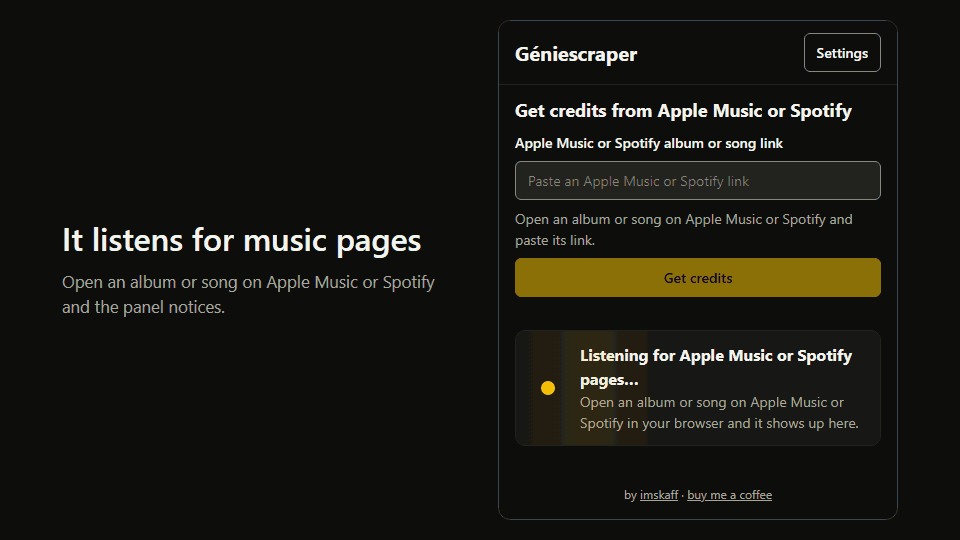

<div align="center">


🧩 **Prefer the browser?** Géniescraper also comes as a Chrome and Edge extension for Windows and macOS: see [Install the browser extension](#install-the-browser-extension).

# Géniescraper

**Géniescraper** is a Python-based tool that bridges Apple Music credits and Genius.com metadata entry. It uses stealth browser automation to extract songwriters, producers, roles, copyrights, and cover art, then provides a hotkey-driven GUI assistant to paste everything directly into Genius - 100% in accordance with the guidelines.

</div>

## Features

- ⚡ **Fast**: about 5 seconds from link to credits per track, with the next tracks of an album scraped in the background while you paste.
- 🕵️ **Accurate Extraction**: Playwright with stealth patches reads songwriters, producers, every additional role and the ℗ / © lines from Apple Music albums and songs.
- 🖼️ **Exact Cover Art**: the 1000×1000 PNG of the exact release you opened, looked up by its Apple Music catalog ID.
- ▶️ **Official YouTube Link**: in Genius's order: the artist's official music video, else the official lyric video, else the official audio, else the auto-generated upload.
- ⌨️ **Hotkey Assistant**: press `F8` to paste each field into Genius and `F7` to go back; Back and Skip buttons and a clickable step list work with the mouse too.
- 🤖 **Auto-Tab and Auto-Confirm**: moves between Genius fields and picks the autocomplete suggestion for you, so you rarely touch the keyboard. Both can be switched on or off while pasting.
- ⚙️ **Settings Everywhere**: a Settings window over any screen; every change applies and saves immediately and is shared by every copy of the app.

## Installation

Géniescraper comes in two forms, and you only need one: the **browser extension** (nothing to install but the extension itself) or the **desktop app** (Windows, Python).

### Install the browser extension



The panel listens for Apple Music pages you already have open and offers them in one press, reads the credits, and can fill the Genius form by itself (Auto-paste) while you watch; it never presses Save.

No store and no command line needed.

1. **Download.** Open the [Releases page](https://github.com/imskaff/geniescraper/releases), pick the newest **Géniescraper extension**, and download `geniescraper-extension-<version>.zip`.
2. **Unzip it into a folder you will keep**, for example `Documents\Geniescraper-extension` (right-click the zip, then Extract All).
   Chrome runs the extension from that folder, so do not delete or move it afterwards.
3. **Add it to your browser.**
   - Chrome: open `chrome://extensions`, switch on **Developer mode** (top right), click **Load unpacked**, and choose the folder from step 2 (the one that contains `manifest.json`).
   - Edge: open `edge://extensions`, switch on **Developer mode** (left side), click **Load unpacked**, and choose the same folder.
4. **Open it.** Click the puzzle-piece icon in the toolbar and pin Géniescraper, then click it: the side panel opens, and a short set-up walks you through the options.

Good to know:

- Chrome may show "Disable developer mode extensions" when it starts; choose to keep them. This is Chrome's standard notice for any extension that is not from the store.
- **To update**, download the newest zip, unzip it over the same folder (replace the files), then press the reload icon on the extension's card in `chrome://extensions`. The extension does not update itself.
- To check a download, compare its SHA-256 with `SHA256SUMS.txt` from the same release.
- If there is no release yet, build it yourself: `cd extension`, `npm ci`, `npm run build`, and load the `extension/dist` folder in step 3.
- Questions and fixes: [extension/FAQ.md](extension/FAQ.md). What the extension sends where: [extension/PRIVACY.md](extension/PRIVACY.md).

### Install the desktop app

#### Prerequisites
- **Windows**
- **Python 3.10+**
- **[uv](https://docs.astral.sh/uv/)** (`pip install uv`)

#### Setup

1. **Clone the repository:**
   ```bash
   git clone https://github.com/imskaff/geniescraper.git
   cd geniescraper
   ```

2. **Install dependencies** (creates `.venv` from the locked versions in `uv.lock`):
   ```bash
   uv sync
   ```
   Without uv, `pip install -r requirements.txt` also works, with unpinned versions.

3. **Install the Playwright browser:**
   ```bash
   uv run playwright install chromium
   ```

## Usage

```bash
uv run python gui_main.py
```

1. **Link** - Paste an Apple Music album or song link and click **Get credits**.
   The app tells you right away if the link is not one it can read.
   Album links are best, because they include the copyright lines (℗ and ©).
2. **Tracks** - For an album, tick the songs to paste, or choose all of them.
3. **Review** - Check the credits, copyright lines, YouTube link and cover art that were found, then click **Start pasting** (or press **F8**).
4. **Paste** - Open the song's edit page on Genius, click **Written By**, and follow the on-screen instruction for each step:
   - Press **F8** to paste the current value and move on.
   - Press **F7** or click **Back** to go back one step.
   - Click **Skip** for a field that is already filled on Genius.
   - Click any step in the list to jump to it.
   - Press **Esc** to end pasting for the song.

With the browser extension paired (Settings, Desktop app), the Link screen also lists the Apple Music albums and songs open in your browser; click one to get its credits.

**⚙ Settings** is on every screen, including while you paste, and every change applies and saves immediately.
Auto-tab and Auto-confirm can also be switched on or off from the pasting screen.

### Field order

The assistant pastes fields in the order Genius expects them:

| # | Field | Notes |
|---|-------|-------|
| 1 | Written By | One artist per press |
| 2 | Produced By | One artist per press |
| 3 | Additional Credits | Role name, then each artist in that role |
| 4 | Phonographic Copyright (℗) | Role name typed, then each label |
| 5 | Copyright (©) | Role name typed, then each label |
| 6 | YouTube URL | Copied to clipboard |
| 7 | Cover Art URL | 1000×1000 PNG, copied to clipboard |

### Auto-Tab

When **Auto-Tab** is enabled in Settings, the assistant automatically navigates between Genius fields after each paste:

| After pasting… | Action |
|---------------|--------|
| Last songwriter | Tab → Produced By field |
| Last songwriter (no producers) | Tab × 2 + Enter → Add additional credits |
| Last producer | Tab + Enter → Add additional credits |
| Last artist in a role | Tab + Enter → Add additional credits |
| Last copyright label | Tab × 3 → YouTube URL field |
| YouTube URL | Tab × 3 → Cover Art field |

Auto-Tab is disabled by default.

## Configuration

Open **⚙ Settings** from any screen:

| Setting | Default | Description |
|---------|---------|-------------|
| Hotkey (Next) | F8 | Paste current field and advance |
| Hotkey (Back) | F7 | Step back one field |
| Auto-confirm | On | Press Enter after paste to confirm autocomplete |
| Wait for suggestions to settle | 0.6 s | How long to wait for Genius's suggestions before confirming |
| Auto-tab | Off | Automatically Tab between Genius fields |
| Compact mode | Off | Hide queue list and shrink the window |
| Always on top | On | Keep the window above the browser |
| Auto-start assistant | Off | Start automatically after a countdown |
| Auto-start delay | 15 s | Seconds before auto-start fires |
| Scrape core credits | On | Songwriters and producers |
| Scrape additional credits | On | All other roles |
| Scrape copyright | On | ℗ and © |
| Scrape YouTube | On | YouTube video/MV link |
| Scrape cover art | On | Album cover at 1000×1000 PNG |

Settings are saved per user in `%APPDATA%\Geniescraper\settings.env`, so every copy of the app shares them.
A `.env` in the project root from older versions is still read until the first save.

## Development

Install the git hooks once per clone (all worktrees of a clone share them):

```bash
uv run pre-commit install
```

Every commit then runs ruff check, ruff format --check, basedpyright and the offline `pytest` suite, and for changes under `extension/` also its lint, type check, tests and build, the same checks CI runs on each push and pull request.
The offline suite includes the fixture parsers, so run `uv run playwright install chromium` first.
Never skip the hooks with `--no-verify`; fix the failure instead.
CI (`.github/workflows/ci.yml`, `windows-latest`) runs the same checks on every push and pull request; the live tests run weekly and on manual dispatch, so Apple Music markup changes show up without blocking pushes.

```bash
uv run ruff check . && uv run ruff format --check .
```

```bash
uv run basedpyright
```

```bash
uv run pytest
```

```bash
uv run pytest -m live
```

```bash
uv run python -m bench.run
```

- `basedpyright` type checks the project in `standard` mode (configured in `pyproject.toml`).
  Known errors in `gui/app.py` are recorded in `.basedpyright/baseline.json`, so only new errors fail; fixed ones drop out of the baseline automatically on the next run.
  Never regenerate the baseline (`--writebaseline`) to hide a new error; fix it instead.
- `uv run pytest` runs the fast offline suite: unit tests, the real parsers against saved Apple Music HTML in `tests/fixtures/`, and the lookups against saved responses.
- `-m live` runs the full scrape flow against live Apple Music and compares it with the hand-reviewed expectations in `tests/golden/`.
- `bench.run` measures latency, accuracy and run-to-run stability over the cases in `bench/cases.json`.
- `uv run python -m bench.capture` refreshes fixtures when Apple changes its markup; it never overwrites a golden file.
- `uv run python -m bench.lookups` measures the YouTube and cover art lookups alone: accuracy against the hand-verified videos in `tests/golden/youtube.json` and the golden cover artwork, plus latency.
- `uv run python -m bench.capture_lookups` refreshes the saved YouTube, Deezer and iTunes responses in `tests/fixtures/lookups/` that the offline lookup tests replay.

### Browser extension

The Chrome extension lives in `extension/` (TypeScript, built with esbuild, tested with Vitest); see [docs/extension-plan.md](docs/extension-plan.md) for the design and slices.
It needs Node 20 or newer and is installed from the lockfile:

```bash
cd extension && npm ci && npm run check
```

`npm run check` runs Prettier (`npm run format` fixes), ESLint, `tsc`, Vitest and the build; `dist/` is the unpacked extension.
`extension/data/roles.json` and `extension/test/vectors.json` are generated from the Python code and must never be edited by hand:

```bash
uv run python -m tools.export_roles && uv run python -m tools.export_vectors
```

A Python test fails when either file is stale, so run both after changing `scraper/roles.py`, `scraper/models.py`, `scraper/apple_music.py`, `scraper/deezer.py`, `scraper/text.py` or `assistant/flow.py`.

To try the extension, run `npm run build`, open `chrome://extensions`, switch on Developer mode, choose Load unpacked and pick `extension/dist`.
The toolbar button opens the side panel: paste an Apple Music album or song link (or open one and the panel offers it), choose tracks with **Select all** or by ticking them (none are ticked for you), and review the credits and the paste queue (collapsed until you open it).
**Start pasting** is in the header next to Settings, and **Back to main menu** returns to the start.
The cover is Apple's exact 1000x1000 PNG for the album you opened, looked up by its catalog id on `itunes.apple.com`, and it is filled into Genius's Song Art field.
Review the credits, open the song's **Edit Metadata** form on Genius, and click **Start pasting**: the extension fills the fields by itself, with a short pause between them (the pace is in Settings).
**Step by step** is the other way: one field per press of **F8** (**F7** goes back); Settings can make it the main way instead.
Automatic pasting pauses when you click or type in the form, press Esc or turn the **Auto-paste: ON** switch off, or close the panel, and turning it back on carries on from the same step; it never clicks Save, so you check the form and save it yourself.
When Genius has no exact match for a name or role the text stays typed and nothing is chosen for you: pick a suggestion yourself, or press Skip in the panel.
The first time the panel opens, a short set-up walks you through what to paste, speed and keys, and the optional look-ups.
Keys, auto-confirm, the suggestion wait and how many tracks are read at once (3 by default) are in the panel's Settings.
A Deezer cover fallback and the YouTube link look-up are off until you tick them in Settings; Chrome then asks for permission to contact api.deezer.com or www.youtube.com, and you can take it back there or in chrome://extensions.
The YouTube look-up reads YouTube's own pages (it has no API for this), which its terms do not allow for automated use: it is optional for that reason.
For reliable YouTube links you can add your own free YouTube Data API key in Settings ("Better YouTube links"): the panel walks you through getting one, step by step, with a link to each Google page.
The key stays in this browser, is sent only to Google, and is not synced.

`npm run live:panel -- --chrome <path to Chromium> --screenshots <folder>` drives the real panel with real key presses against the real service worker and live Apple Music (a whole 10-track album), checks the result against the golden file, and saves screenshots in both color schemes and at 320 px.
`npm run live:sidepanel -- --chrome <path to Chromium>` checks the way the extension is really used: a genuine side panel next to a visible album tab, reading that tab in place.

`npm run live:genius -- --chrome <path to Chromium> --profile <folder>` drives the real extension through a whole paste into a live Genius edit form of a song you created, with a Chromium profile you signed in to by hand; `--mode auto` starts the automatic run and checks that the Auto-paste switch, Esc, a real click in the form and the panel closing each pause it and that turning it back on carries on; it never presses Save.
`npm run live:hidden-tab -- --chrome <path to Chromium>` is an opt-in live check against Apple Music that the extension can read song pages in a genuinely hidden tab; run `npm run build` first, and find a Chromium with `uv run python -c "from playwright.sync_api import sync_playwright as s; p = s().start(); print(p.chromium.executable_path); p.stop()"`.

## License

MIT - see [LICENSE](LICENSE).
